# texas-turnout-scraper

Python library, CLI (`tx-turnout`), MCP server and Cloudflare pipeline for Texas early-voting
turnout and voter rosters, from the Secretary of State's Civix EVR portal (2025+) and the legacy
SOS portal (pre-2025).

[](https://github.com/Abstract-Data/texas-turnout-scraper/actions/workflows/ci.yml)
[](https://github.com/Abstract-Data/texas-turnout-scraper/actions/workflows/data-refresh.yml)
[](https://www.python.org/downloads/)
[](https://github.com/astral-sh/uv)
[](infra/ev_ingest/README.md)
[](docs/CIVIX_EVR_API.md)
[](docs/EARLY_VOTING_ROSTER.md)

## Overview

| Surface | What it is | Where |
|---|---|---|
| **Library** | Pydantic v2 models and scrapers for both portals | [`src/texas_turnout_scraper/`](src/texas_turnout_scraper/) |
| **CLI** | `tx-turnout`: rosters, turnout, audits, voterfile matching, gap reports, API keys | [`src/texas_turnout_scraper/cli/`](src/texas_turnout_scraper/cli/) |
| **MCP server** | FastMCP tools for agents (Civix and legacy fetches, audit) | [`src/texas_turnout_scraper/mcp_server.py`](src/texas_turnout_scraper/mcp_server.py) |
| **Early-vote loader** | Statewide Civix roster → R2 snapshots → D1 → KV, per EV day | `early_vote_*.py`, [`scripts/ev_ingest_steps.sh`](scripts/ev_ingest_steps.sh) |
| **Ingest Container** | Cloudflare Worker + Durable Object + Container that runs the loader on a schedule | [`infra/ev_ingest/`](infra/ev_ingest/) |
| **Preview read API** | Python (FastAPI) Worker serving per-election aggregates from D1 | [`infra/preview/`](infra/preview/) |
| **Local data** | `tx-turnout` output under `data/elections/`; a manual refresh workflow | [`data/`](data/) |

### How data flows

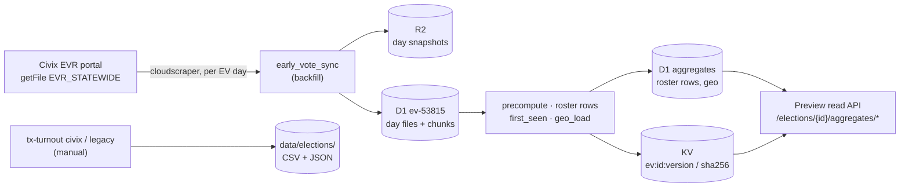

Two paths exist side by side:

- **Live early-vote path (Cloudflare).** For the current election (Civix `53815`, general election
  2026-11-03) the ingest Container pulls every published EV day, writes changed days to R2 and D1,
  rebuilds the aggregates, and bumps KV so the read API serves the new data. Nothing here is
  real-time: the portal posts each day's full roster over the following day, and the loader runs
  three times a day.
- **CLI path (manual).** `tx-turnout civix|legacy fetch-all` writes per-election CSV/JSON under
  `data/elections/`. The [Data Refresh](.github/workflows/data-refresh.yml) workflow is
  `workflow_dispatch` only, and per-voter rosters must not be committed to this repo. The GitHub
  Pages static API of [ADR-003](docs/adr/003-github-pages-static-api.md) is no longer the
  production path; live data is D1/KV.

## Install

```bash
uv sync --dev          # library, CLI, MCP, voterfile, waf, loader and geo extras plus dev tools
```

Extras for downstream installs (`pip install texas-turnout-scraper[...]`):

| Extra | Adds | Needed for |
|---|---|---|
| `cli` | typer, rich, questionary | `tx-turnout` |
| `mcp` | `mcp[cli]` | the MCP server |
| `voterfile` | duckdb | `tx-turnout voterfile` |
| `waf` | cloudscraper | the default HTTP backend against the portals' WAF |
| `loader` | sqlmodel | the D1 loaders ([ADR-009](docs/adr/009-sqlmodel-roster-models.md)) |
| `geo` | shapely, pyproj, pyshp | the offline geography build only ([ADR-010](docs/adr/010-geography-tables.md)) |

## CLI

```bash
# Civix EVR (2025+)
uv run tx-turnout civix elections                 # newest first; arrow-key menus in a TTY
uv run tx-turnout civix elections --no-interactive
uv run tx-turnout civix turnout 53813 2025-03-01
uv run tx-turnout civix roster 53813 2025-03-01
uv run tx-turnout civix fetch-all 53813           # every EV day → data/elections/civix/53813/roster_ev_53813.csv
uv run tx-turnout civix refresh-all               # certified elections with stale files
uv run tx-turnout civix gap-report 58315          # turnout vs roster, county by county

# Legacy SOS portal (pre-2025)
uv run tx-turnout legacy elections
uv run tx-turnout legacy turnout 49664 2024-10-21
uv run tx-turnout legacy roster 49664 2024-10-21 --strategy B --out-dir ./data/tmp
uv run tx-turnout legacy fetch-all 49664

# Audit and voterfile match
uv run tx-turnout audit run 58315
uv run tx-turnout audit run-inline data/elections/civix/58315/roster_ev_58315.csv
uv run tx-turnout voterfile detect-columns /path/to/voterfile.csv
uv run tx-turnout voterfile match data/elections/civix/58315/roster_ev_58315.csv /path/to/voterfile.csv --no-interactive

# Preview read API keys (stored in 1Password, hashed in D1/KV; needs `op signin`)
uv run tx-turnout api generate --name "Partner" --email partner@example.org --days 30
uv run tx-turnout api list
uv run tx-turnout api extend <token_id> --days 30
uv run tx-turnout api revoke <token_id>
```

Each group has `--help`. EV dates are `YYYY-MM-DD` strings. The default HTTP backend is
cloudscraper; tests use `http_backend="httpx"`.

## Early-vote pipeline (Cloudflare)

| Piece | Name | Notes |
|---|---|---|
| D1 | `ev-53815` | Day files and chunks, aggregates, roster rows, first-seen counts, geography, voter geography |
| D1 | `tx-turnout-preview` | API consumer keys |
| R2 | `tx-turnout-ev-snapshots-preview` | One gzip snapshot + manifest per EV day |
| KV | `ev:<id>:version`, `ev:<id>:sha256` | What the read API treats as published |
| Worker | `tx-turnout-ev-ingest-preview` | Cron + Durable Object `EvIngest` + Container ([ADR-017](docs/adr/017-cloudflare-container-ingest.md)) |
| Worker | `tx-turnout-ev-api-preview` | Read API, behind Cloudflare Access + an API key ([`infra/preview/README.md`](infra/preview/README.md)) |

### Scheduled run

The cron `0 15,16,22,23,3,4 * * *` (UTC) starts a run at **10:00, 17:00 and 22:00 Central**
through 11:59 PM on 2026-11-03. `EV_SYNC_MODE` in
[`infra/ev_ingest/wrangler.jsonc`](infra/ev_ingest/wrangler.jsonc) gates it: `off` (nothing runs),
`dry_run` (hash every day, write nothing) or `apply`. A deploy resets the variable to the file's
value. A run executes [`scripts/ev_ingest_steps.sh`](scripts/ev_ingest_steps.sh): the backfill
sync, the aggregate precompute, roster rows, `first_seen_build` and `geo_load`. Results are in
Workers Logs as `ev-ingest started` / `ev-ingest finished` with `exit_code` and the steps'
`key=value` report lines.

The run's flow, and every other pipeline, is drawn in [Pipeline flows](#pipeline-flows).

### Local run

The same steps run on a laptop, with secrets from the 1Password Environment:

```bash
op signin                                   # interactive; the script does not retry an expired session
bash scripts/local_ev_backfill.sh           # apply
bash scripts/local_ev_backfill.sh dry_run   # hash every day, write nothing
```

Voter attributes (`voter_link`, local only because the voterfile is PII), voter geography
(`voter_geo_build`, not in the scheduled run) and repeat VUIDs (paused until after 2026-11-03) are
separate local steps; see [`RUNBOOK.md`](RUNBOOK.md).

### Preview read API

`GET /health` and, per election, `/elections/{id}/aggregates/totals`, `/by-day`, `/by-method`,
`/county` and `/county-by-day`. Requests need the Cloudflare Access service-token headers and an
API key from `tx-turnout api generate`. Setup, Terraform and key handling:
[`infra/preview/README.md`](infra/preview/README.md).

## Pipeline flows

| Flow | What it covers | Source |
|---|---|---|
| [Scheduled ingest run](#scheduled-ingest-run) | Cron → Durable Object → Container → alarm, and what the API serves | [`infra/ev_ingest/src/index.ts`](infra/ev_ingest/src/index.ts) · **TLC-checked** |
| [Loader steps](#loader-steps) | The five steps of one run and when KV is bumped | [`scripts/ev_ingest_steps.sh`](scripts/ev_ingest_steps.sh) |
| [Per-day sync](#per-day-sync) | Fetch, hash, skip or write one EV day | [`early_vote_backfill.py`](src/texas_turnout_scraper/early_vote_backfill.py), [`early_vote_sync.py`](src/texas_turnout_scraper/early_vote_sync.py) |
| [Read API request](#read-api-request) | Access, API key, versioned KV cache, D1 | [`infra/preview/worker/src/ev_api/`](infra/preview/worker/src/ev_api/) |
| [API key lifecycle](#api-key-lifecycle) | `tx-turnout api` generate, extend, expire, revoke | [`consumer_token_admin.py`](src/texas_turnout_scraper/consumer_token_admin.py) |
| [Early vote sync workflow](#early-vote-sync-workflow) | Manual loader run in GitHub Actions | [`early-vote-sync.yml`](.github/workflows/early-vote-sync.yml) |
| [Terraform preview workflow](#terraform-preview-workflow) | Validate, plan, apply the preview stack | [`terraform-preview.yml`](.github/workflows/terraform-preview.yml) |
| [CLI scrape and Data Refresh](#cli-scrape-and-data-refresh) | `fetch-all` / `refresh-all` for both portals | [`data-refresh.yml`](.github/workflows/data-refresh.yml), [`cli/`](src/texas_turnout_scraper/cli/) |
| [Local and offline builds](#local-and-offline-builds) | Geography, voter attributes, voter geography, repeat VUIDs | [`RUNBOOK.md`](RUNBOOK.md) |
| [CI and release](#ci-and-release) | CI, Release Please, tzdata, tool config, review | [`.github/workflows/`](.github/workflows/) |

The first chart is drawn from a TLA+ model of the code and checked by TLC (see
[Flow charts](#flow-charts)). The others are drawn by hand from the code and workflow files named
in the table; they are not model-checked.

### Scheduled ingest run

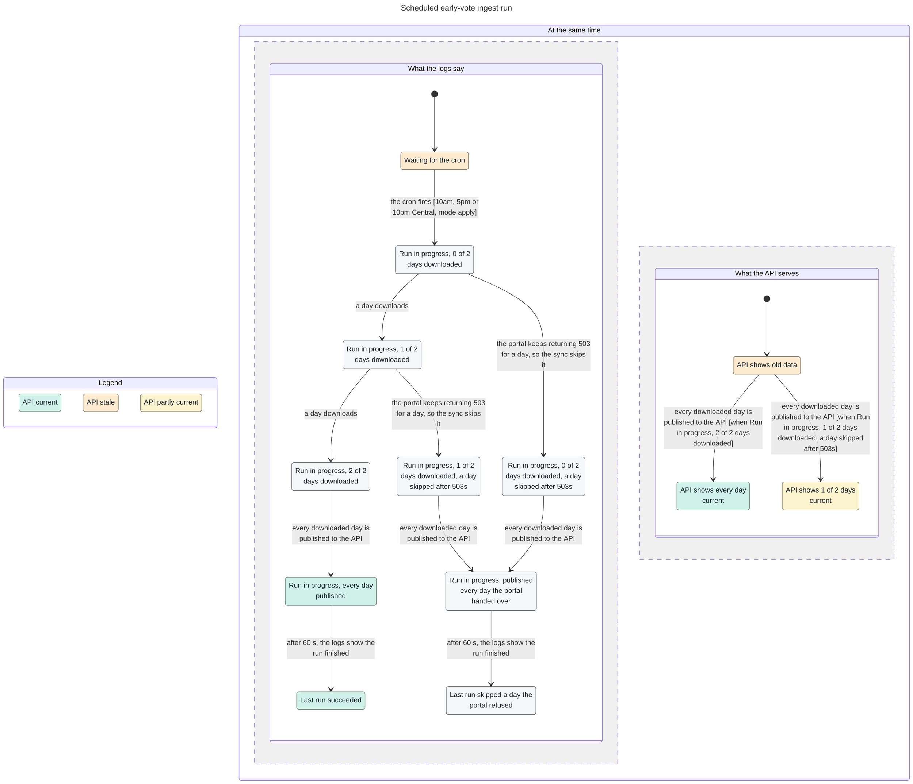

If the portal keeps returning 503 for one day, the sync skips that day, keeps what D1 last stored
for it, and publishes the rest. The run still exits 0, and the "ev-ingest finished" log lists the
skipped days as `days_failed=` and `failed_dates=`. Before this fix, one such day ended the whole run
and left the days already downloaded unpublished, as happened on 2026-10-28 at 15:00 and 22:00 UTC.
The rules, the history and what the model leaves out are in [`docs/flows/README.md`](docs/flows/README.md).

### Loader steps

The same sequence runs in the Container, in `scripts/local_ev_backfill.sh` and, with
`repeat_build` added, in the GitHub *Early vote sync* apply job. Every step after the sync is
idempotent; the precompute is the only step that bumps the KV version the read API caches under.

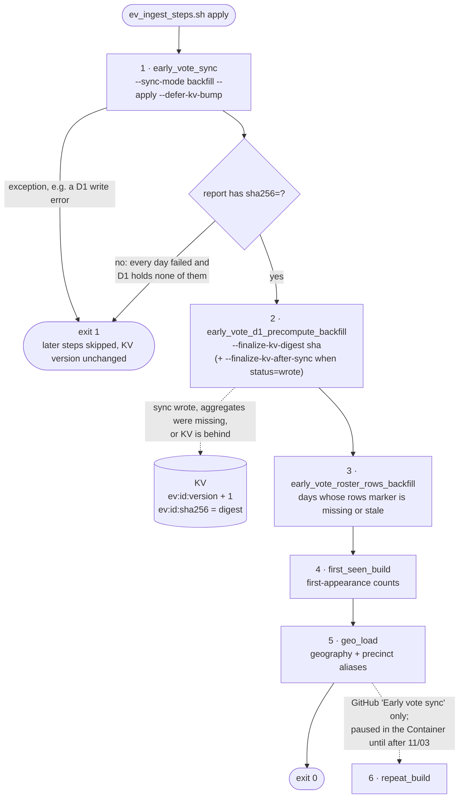

### Per-day sync

The backfill walks the EV calendar in ascending order. Each day's aggregates and roster rows are
written to D1 with the day itself; the later steps only catch up what is missing.

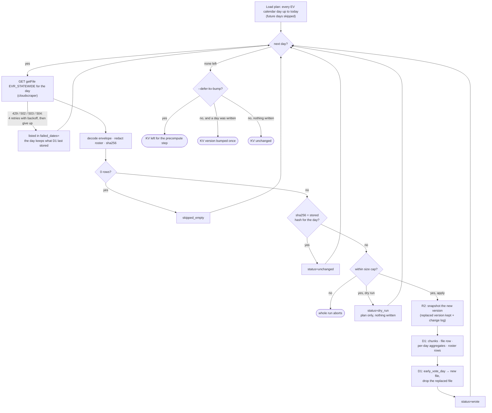

### Read API request

Every route needs the Access service-token pair at the edge and a minted API key in the Worker.
Bodies are cached in KV per published version, so a new version is what makes new data visible.

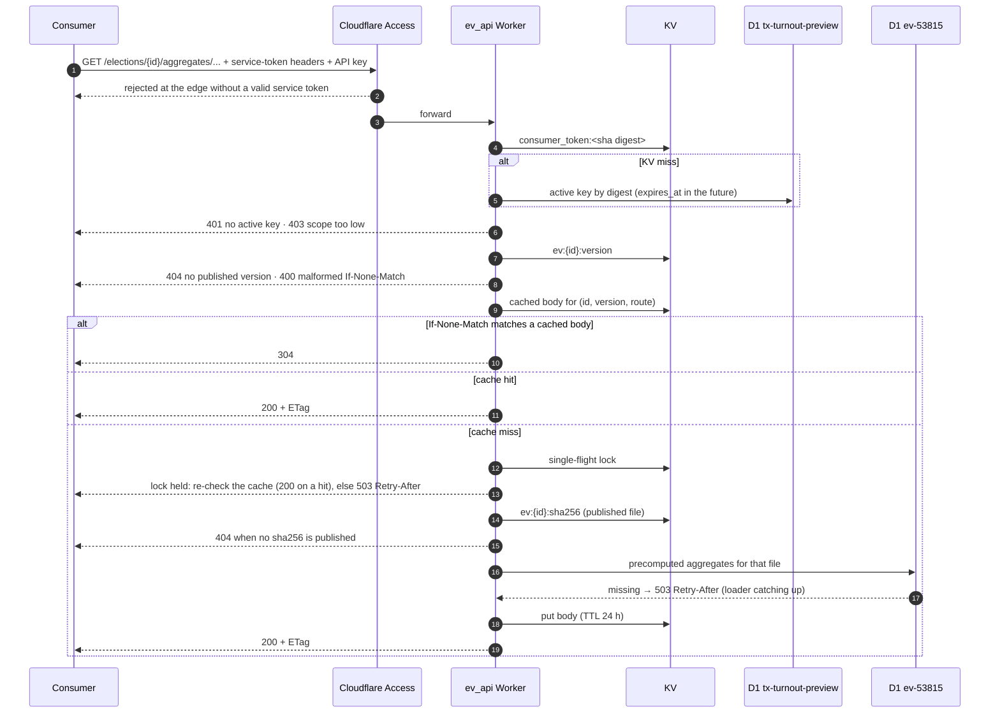

### API key lifecycle

Only HMAC digests are stored in D1 and KV; the plaintext key lives in 1Password.

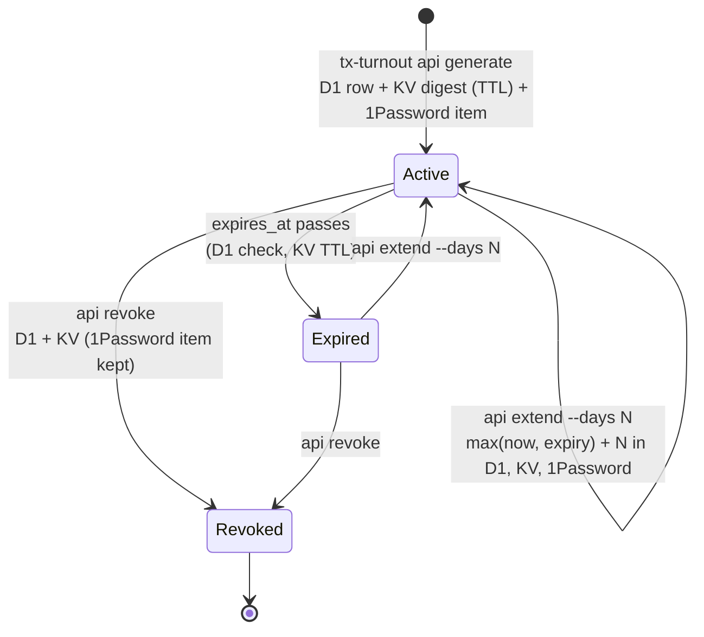

### Early vote sync workflow

Manual only: nothing dispatches it on a schedule since the Container took over the cron
([ADR-017](docs/adr/017-cloudflare-container-ingest.md)).

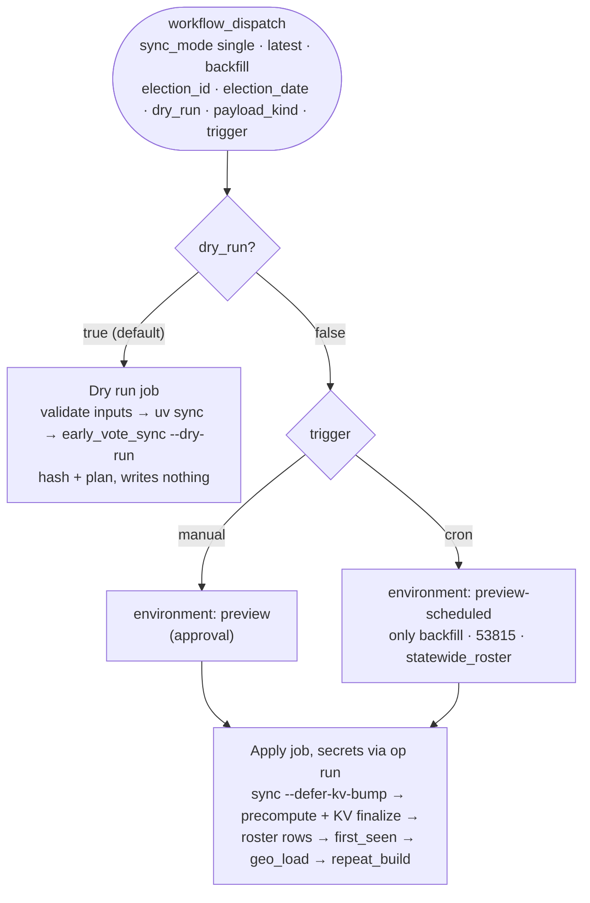

### Terraform preview workflow

Do not run `terraform plan` or `apply` on a laptop; the two approvals are the review gate.

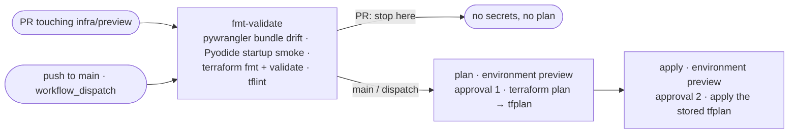

### CLI scrape and Data Refresh

The manual path that writes CSV/JSON under `data/elections/`. Per-voter rosters for new elections
must not be committed.

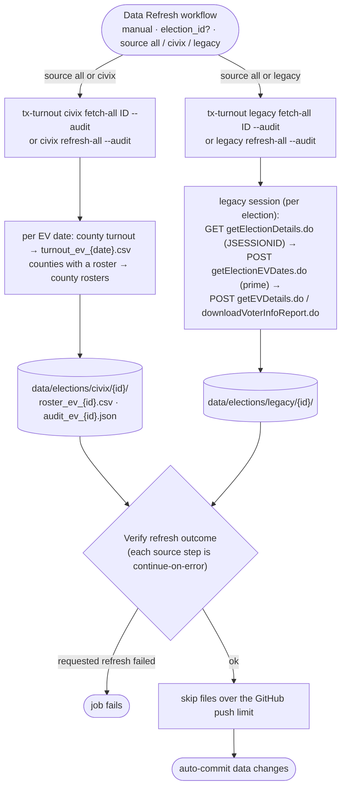

### Local and offline builds

Steps that need PII or heavy geometry libraries run on the owner's machine, not in the Container.

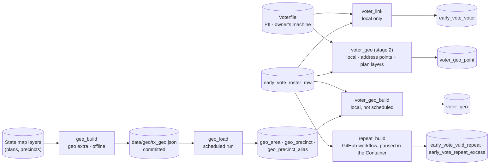

### CI and release

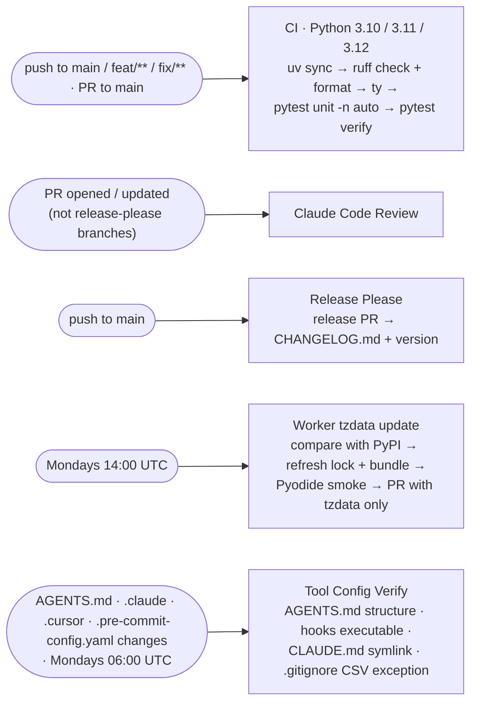


## Turnout vs roster gap analysis

Civix publishes two different numbers during early voting:

| Source | What it counts |
|---|---|
| **Turnout table** | County cumulative ballot totals (in-person + mail), what SOS posts online |
| **Roster CSVs** | Named voters in the per-county detail files, what `fetch-all` scrapes |

`tx-turnout civix gap-report <id>` compares them county by county: `turnout_total − roster_total`,
split by in-person and mail. Mail ballots often reach the turnout table before the rosters, most of
all while an election is uncertified.

- **Roster side:** unique VUIDs per county from `roster_ev_{id}.csv`.
- **Turnout side** (`--turnout-source`): `auto` (saved `turnout_ev_{date}.csv` if present, else
  live), `stored`, or `live`. `civix fetch-all` saves a turnout snapshot per EV day so later reports
  compare against what was online at scrape time.
- `voterfile match` runs the gap report by default for Civix rosters (`--no-gap-report` to skip).

| Output | Description |
|---|---|
| `gap_report_ev_{id}.json`, `gap_counties_ev_{id}.csv` | From `civix gap-report` |
| `gap_report_{roster_stem}.json`, `gap_counties_{roster_stem}.csv` | From `voterfile match` |
| `match_report_*.json` | Includes `turnout_roster_gap` when the gap analysis ran |

Code: [`gap_analysis.py`](src/texas_turnout_scraper/gap_analysis.py),
[`terminal_report.py`](src/texas_turnout_scraper/terminal_report.py).

## MCP server

Tools: `civix_list_elections`, `civix_fetch_turnout`, `civix_fetch_county_roster`,
`civix_fetch_ed_turnout`, `civix_fetch_polling_places`, `legacy_list_elections`,
`legacy_fetch_turnout`, `legacy_fetch_county_roster` and `run_audit`. Every tool has a test in
`tests/unit/test_mcp_server.py`, and `tests/verify/` blocks a merge without one.

## Development

```bash
uv sync --dev
uv run ruff check . --fix && uv run ruff format .
uv run ty check
uv run pytest tests/unit -q -n auto          # mocked HTTP (respx), no network
uv run pytest tests/verify -q                # structural checks (AGENTS.md, MCP tests, cron, logging)
uv run pytest tests/integration -v --live    # hits the live portals
cd infra/ev_ingest && npm ci && npx tsc --noEmit && npm test
```

Branches go through [GitButler](docs/GITBUTLER.md) (`but`), not raw `git branch`/`checkout -b`.
Conventional commits on `main` feed [Release Please](docs/adr/005-release-please.md).

| Workflow | Runs |
|---|---|
| [`ci.yml`](.github/workflows/ci.yml) | Lint, types, unit and verify tests on pushes and PRs |
| [`data-refresh.yml`](.github/workflows/data-refresh.yml) | Manual refresh of `data/` (no schedule) |
| [`early-vote-sync.yml`](.github/workflows/early-vote-sync.yml) | Manual loader run (single date, latest, or backfill) |
| [`terraform-preview.yml`](.github/workflows/terraform-preview.yml) | Validate on PRs; plan/apply the preview stack on `main` with approval |
| [`release-please.yml`](.github/workflows/release-please.yml) | Release PRs and the changelog |
| [`tzdata-update.yml`](.github/workflows/tzdata-update.yml) | Weekly tzdata refresh for the Worker |

## Flow charts

The [Scheduled ingest run](#scheduled-ingest-run) chart comes from a TLA+ model in
[`docs/flows/`](docs/flows/), drawn and checked with the pstack `statechart` skill: TLC explores
every state of the model, checks each rule, and draws the result. The model ties each condition to
the code with file:line comments. [`docs/flows/README.md`](docs/flows/README.md) has the rules, the
bug the checker found, and the command that regenerates the chart. The other diagrams in
[Pipeline flows](#pipeline-flows) are hand-drawn from the code; update them with the code they
describe.

## Documentation

- [`AGENTS.md`](AGENTS.md): constraints, layout and conventions for agents and contributors
- [`RUNBOOK.md`](RUNBOOK.md): operations, loader steps, D1 tables, common issues
- [`docs/ARCHITECTURE_SPEC.md`](docs/ARCHITECTURE_SPEC.md) and [`docs/ARCHITECTURE.md`](docs/ARCHITECTURE.md): design
- [`docs/CIVIX_EVR_API.md`](docs/CIVIX_EVR_API.md): Civix EVR API reference
- [`docs/EARLY_VOTING_ROSTER.md`](docs/EARLY_VOTING_ROSTER.md): legacy SOS HTTP flow
- [`docs/EARLY_VOTE_VUID_ANOMALIES.md`](docs/EARLY_VOTE_VUID_ANOMALIES.md): VUID anomalies in the rosters
- [`docs/GUARDRAILS.md`](docs/GUARDRAILS.md), [`docs/TESTING.md`](docs/TESTING.md), [`SECURITY.md`](SECURITY.md)
- [`infra/ev_ingest/README.md`](infra/ev_ingest/README.md), [`infra/preview/README.md`](infra/preview/README.md)

### Architecture decisions

| ADR | Decision | Status |
|---|---|---|
| [001](docs/adr/001-httpx-over-selenium.md) | httpx instead of Selenium | Accepted |
| [002](docs/adr/002-pydantic-over-sqlmodel.md) | Pydantic v2 models | Accepted (narrowed by 009) |
| [003](docs/adr/003-github-pages-static-api.md) | GitHub Pages as static JSON/CSV API | Accepted; no longer the production path |
| [004](docs/adr/004-civix-evr-source.md) | Civix EVR as a second source | Accepted |
| [005](docs/adr/005-release-please.md) | Release Please | Accepted |
| [006](docs/adr/006-gitbutler-virtual-branches.md) | GitButler virtual branches | Accepted |
| [007](docs/adr/007-ty-migration-to-error-mode.md) | `ty` error-mode ratchet | Accepted |
| [008](docs/adr/008-rostersource-protocol.md) | `RosterSource` protocol for both sources | Proposed |
| [009](docs/adr/009-sqlmodel-roster-models.md) | SQLModel for D1 roster rows | Accepted |
| [010](docs/adr/010-geography-tables.md) | Geography tables in D1 | Accepted |
| [011](docs/adr/011-voter-attributes.md) | Voter attributes in D1 | Accepted |
| [012](docs/adr/012-repeat-vuids.md) | Repeat VUIDs in D1 | Accepted |
| [013](docs/adr/013-worker-cron-dispatches-sync.md) | Worker cron dispatches the sync | Accepted |
| [014](docs/adr/014-cloudflare-workflow-ingest.md) | Ingest as a Cloudflare Workflow | Proposed (superseded by 017 once accepted) |
| [015](docs/adr/015-voter-geography.md) | Per-voter geography in D1 | Proposed |
| [016](docs/adr/016-first-appearance-voter-counts.md) | Distinct voters and county FIPS in the API | Accepted |
| [017](docs/adr/017-cloudflare-container-ingest.md) | Ingest in a Cloudflare Container | Proposed, running in `apply` |

## Data and PII

Voter names and VUIDs are public record under the Texas Election Code, but the code never logs
them or puts them in error messages; logs and reports carry counts and hashes only. The R2 bucket
and D1 databases are private, and the live early-vote data is served only by the authenticated
preview API. Per-voter roster CSVs are not committed for new elections (see
[`data-refresh.yml`](.github/workflows/data-refresh.yml)).
